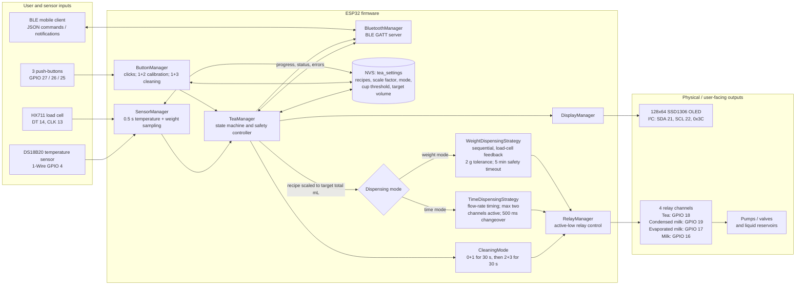
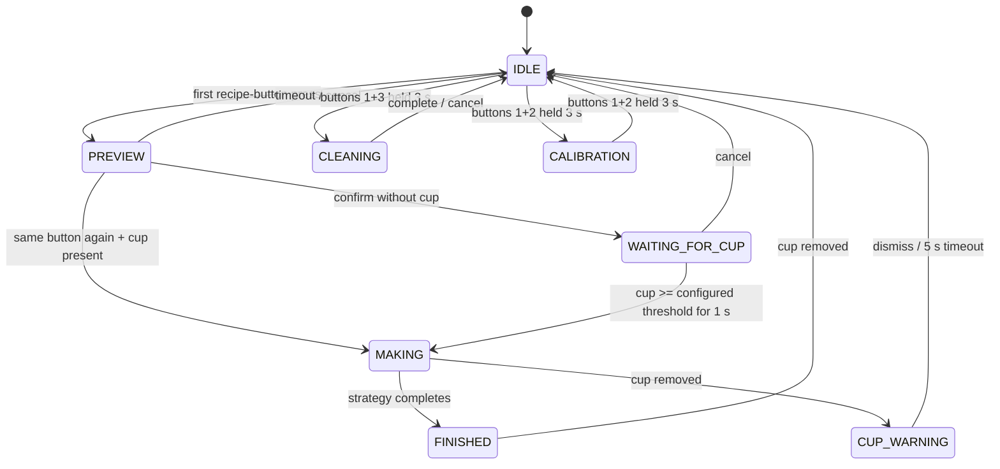

# Tea Mixer block diagram

`project_tea` is an ESP32-based, four-liquid dispenser. `TeaManager` is the
application controller: it processes local/BLE requests, enforces cup-safety,
selects a dispensing strategy, and coordinates the user interfaces.

## Control loop

`loop()` runs every ~20 ms: `ButtonManager.update()`, `SensorManager.update()`,
then `TeaManager.update()`. Sensor readings refresh every 500 ms; dispensing
state and progress are evaluated every 100 ms while making tea.

## TeaManager states

The BLE `MAKE_TEA` command bypasses the preview but still uses the cup check,
recipe scaling, active dispensing strategy, display updates, and BLE status
notifications.
